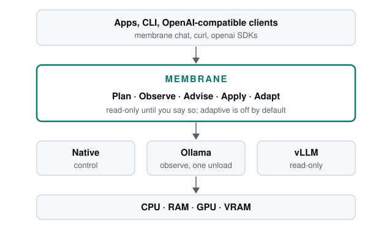

<div align="center">

<picture>
  <source media="(prefers-color-scheme: dark)" srcset="docs/assets/brand/membrane-logo-dark.svg">
  
</picture>

**Hardware-aware memory intelligence and control for local LLM inference.**

Plan, observe, advise, apply, and adapt local model workloads across runtimes.

[](https://github.com/kadireren7/membrane/actions/workflows/ci.yml)
[](https://github.com/kadireren7/membrane/actions/workflows/codeql.yml)
[](LICENSE)
[](https://github.com/kadireren7/membrane/releases)

</div>

MEMBRANE picks a local model that fits your computer, shows what memory is doing,
and serves it through a local chat and an OpenAI-compatible API. It sits on top of
runtimes such as llama.cpp, Ollama and vLLM; it does not replace them.

## Install & start

**[Download the latest release](https://github.com/kadireren7/membrane/releases/latest)**,
then pick the one file for your computer (`<version>` is the release number, currently `1.2.0`):

| Platform | Download |
|---|---|
| Linux (Debian / Ubuntu / Pop!_OS, amd64) | `membrane_<version>_amd64.deb` |
| macOS (Apple Silicon) | `membrane_<version>_macos_arm64.tar.gz` |
| Windows (x86_64) | `membrane_<version>_windows_x86_64.zip` |

**Linux.** Install the downloaded file with `apt` (it resolves dependencies; a plain
double-click or `dpkg -i` may not):

```bash
cd ~/Downloads
sudo apt install ./membrane_1.2.0_amd64.deb
membrane --version
```

This is the normal build: it includes Vulkan support and still works CPU-only. If you
want a CPU-only package, `membrane-cpu_<version>_amd64.deb` installs the same way.

**macOS.** Extract the archive and run the bundled binary (add `bin` to your `PATH`
if you like):

```bash
tar -xzf membrane_1.2.0_macos_arm64.tar.gz
./membrane_1.2.0_macos_arm64/bin/membrane --version
```

**Windows.** Extract the ZIP (right-click, *Extract All*) and run it from PowerShell:

```powershell
.\membrane_1.2.0_windows_x86_64\bin\membrane.exe --version
```

The macOS and Windows archives are currently **unsigned**, so Gatekeeper or SmartScreen
may warn the first time: see [install](docs/install.md) for what to do, and verify the
file against `SHA256SUMS` from the same release page.

**Then, on any platform:**

```bash
membrane            # status screen and the next step
membrane doctor     # check the installation and your hardware
membrane use        # pick and download a model
membrane chat       # start chatting
```

You do not need to know model IDs: `membrane use` shows a list, and a partly typed name
gets a "Did you mean?" you confirm. `membrane setup` is the guided first run including
the background service. More: [quickstart](docs/quickstart.md),
[install](docs/install.md) (all platforms, building from source),
[support matrix](docs/support-matrix.md).

## What MEMBRANE does

Running a local model means guessing: which model fits, how much context, what
the GPU can hold, why memory just filled up. MEMBRANE answers those with
measurements instead of guesses.

- **Picks and runs models for your hardware.** A catalog, an interactive picker,
  and `models recommend` for what suits *this* computer.
- **Explains memory.** `observe` shows what is happening now; `advise` says what
  it means. Every number says where it came from (measured, reported by the
  runtime, estimated), and unknown stays unknown.
- **Changes things only when you say so.** `apply` is a dry run unless you pass
  `--yes`. It re-checks live state first and rolls back on failure.
- **Can adapt, if you opt in.** Adaptive mode is off by default and bounded when
  on: it reacts to *sustained* pressure, with cooldowns, and never overrides
  your manual changes.
- **Serves a local OpenAI-compatible API** at `http://127.0.0.1:8642/v1`.



## How it works

```
Select → Plan → Run → Observe → Advise → Apply → Adapt
```

| Step | In one sentence |
|---|---|
| **Select** | Choose a model from the catalog or your own GGUF files. |
| **Plan** | Work out GPU layers, KV precision and placement for this hardware, with reasons. |
| **Run** | Serve it locally, on the runtime that fits (`membrane run`). |
| **Observe** | Read memory and runtime state, each fact labeled by provenance. |
| **Advise** | Turn pressure into explainable, capability-aware recommendations. |
| **Apply** | Carry out an explicit change you approved, safely. |
| **Adapt** | Optionally repeat that loop within strict bounds. |

## What it is, and what it is not

llama.cpp, Ollama and vLLM execute inference, and they do it well. MEMBRANE adds
hardware-aware planning, memory intelligence, control and orchestration *above*
supported runtimes. It does not replace them, and it does not modify llama.cpp.
It is also not a model (a small model is still a small model), not a web UI, and
not a complete OpenAI API.

## Core commands

| Command | What it does |
|---|---|
| `membrane` | Status screen and the suggested next step. |
| `membrane use [MODEL]` | Install (with consent) and select a model. |
| `membrane models` | Installed models; `available` and `recommend` subcommands. |
| `membrane chat` | Terminal chat with the local server. |
| `membrane plan MODEL` | Read-only plan: what would run, and why. |
| `membrane observe` | Read-only snapshot of memory and runtime state. |
| `membrane advise` | Read-only findings and recommendations. |
| `membrane apply` | Dry run of what advice could be applied; `--yes` applies. |
| `membrane adaptive status` | Show, enable or disable opt-in adaptation. |
| `membrane run MODEL` | Choose the runtime that fits and say why (`--explain` changes nothing). |
| `membrane doctor` | Diagnose installation, hardware and service. |

Output is human-readable by default. Add `--json` for machine-readable output
(never colored) and `--verbose` for every detail. Color appears only on a terminal
and honors `NO_COLOR`. Every command and flag: [CLI reference](docs/cli-reference.md).

## Runtimes

| Runtime | Inference | Observation | Planning depth | Control | Adaptive | Status |
|---|---|---|---|---|---|---|
| membrane-native (llama.cpp) | yes | full | Planner v2 | context, KV precision/placement, GPU layers, unload, pin, activate | opt-in | supported |
| Ollama | by Ollama | read-only (`/api/ps`) | from reported facts, not planner-grade | explicit unload only | observe / recommend only | scoped; tested against mock servers |
| vLLM | by vLLM | inspect only (models, health, load) | from reported facts, not planner-grade | none; vLLM fixes its memory at launch | no | read-only; tested against mock servers |

MEMBRANE does not launch Ollama or vLLM. It keeps every enumerated GPU in its
hardware picture but does not execute across multiple GPUs. Details:
[orchestration](docs/orchestration.md), [Ollama](docs/runtime-ollama.md),
[vLLM](docs/runtime-vllm.md).

## What MEMBRANE does not do

- No multi-GPU execution or distributed orchestration.
- No tool calling, embeddings or `response_format` (rejected explicitly, never dropped).
- No authentication: the server binds to loopback, and that is the security boundary.
- No claim that it makes any runtime faster; measured results are scoped and listed in
  [direct-cli-and-results](docs/direct-cli-and-results.md).

## Documentation

| | |
|---|---|
| Start | [Quickstart](docs/quickstart.md) · [Install](docs/install.md) · [CLI reference](docs/cli-reference.md) · [Troubleshooting](docs/troubleshooting.md) |
| Concepts | [Architecture](docs/architecture.md) · [Planner](docs/planner-v2-foundation.md) · [Observability](docs/observability.md) · [Memory intelligence](docs/memory-intelligence.md) |
| Control | [Active control](docs/active-control.md) · [Adaptive runtime](docs/adaptive-runtime.md) · [Orchestration](docs/orchestration.md) |
| Runtimes and API | [Support matrix](docs/support-matrix.md) · [API contract](docs/api-contract.md) · [Client compatibility](docs/client-compatibility.md) · [Integrations](docs/integrations.md) |
| Trust | [Security model](docs/security-model.md) · [Model quality](docs/model-quality.md) · [Direct CLI, build options and measured results](docs/direct-cli-and-results.md) |
| Project | [Brand](docs/brand.md) · [Release v1.2.0](docs/release-v1.2.0.md) · [Changelog](CHANGELOG.md) |

## Status and limitations

Release: latest stable tag `v1.2.0` ([notes](docs/release-v1.2.0.md),
[upgrading from v1.1](docs/upgrade-v1.1-to-v1.2.md)). Everything in it is additive:
the OpenAI-compatible API v1, the `--json` shapes and existing configs are unchanged.

- The OpenAI-compatible API is a subset, not the complete API.
- macOS and Windows archives are unsigned; Windows is CPU only, and GPU backends there are not validated on real hardware.
- Ollama and vLLM support was validated against mock servers that follow the audited
  API shapes, not live daemons. Adaptive behavior was validated on a synthetic timeline.
- Model quality depends on the model you choose; MEMBRANE manages the runtime, not
  the intelligence.
- Platform and model evidence is real but scoped to the tested hardware and fixtures.
- CXL and FPGA work is research only, with no production support claimed.

## Research history

Active development happens here, in `kadireren7/membrane`. The archived
[membrane-research](https://github.com/kadireren7/membrane-research) repository holds
historical experiment records and negative results as evidence only. You do not need it
to use MEMBRANE.

## AI-assisted development

Kadir Eren Altıntaş leads architecture, validation criteria and release decisions. AI
coding agents have assisted implementation, documentation and review; see the disclosure
in `membrane-research`'s `outreach/ai-assistance-disclosure.md`.

## License

Apache License 2.0 for MEMBRANE's own code: [LICENSE](LICENSE). The `third_party/llama.cpp`
submodule and model artifacts have their own terms: [licensing](docs/licensing.md).
Citation: [CITATION.cff](CITATION.cff).

Contributing: [CONTRIBUTING.md](CONTRIBUTING.md) · Security: [SECURITY.md](SECURITY.md) ·
Support: [SUPPORT.md](SUPPORT.md) · [Code of conduct](CODE_OF_CONDUCT.md)
